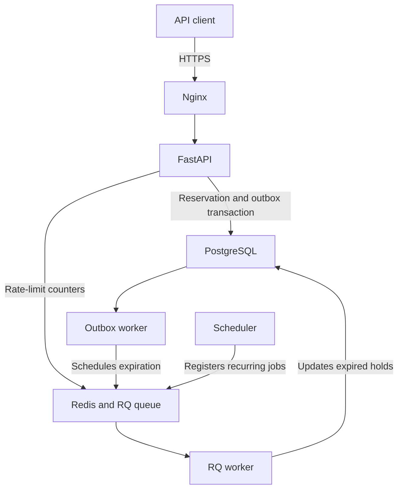

# Booking System

A backend API for reserving seats at events. It handles two common failure cases: competing requests for the same seat and client retries after a timeout. FastAPI serves the API, PostgreSQL stores reservation state, and Redis-backed workers release expired holds.

## Key features

- Create a temporary seat hold, confirm it before expiry, or cancel it while it is pending.
- List your reservations with filters for event, status, and date range, plus sorting and pagination.
- Sign in with JWT access and refresh tokens, rotate refresh tokens, and manage active sessions.
- Process reservation expiry in the background and monitor failed outbox events through an admin endpoint.

## Technology stack

| Area | Technologies |
| --- | --- |
| API | Python 3.14, FastAPI, Pydantic |
| Persistence | PostgreSQL 17, SQLAlchemy, Alembic |
| Security | PyJWT, Argon2 via pwdlib |
| Background processing | Redis 7, RQ |
| Testing and quality | pytest, pytest-cov, Ruff |
| Infrastructure | Docker Compose, Nginx, GitHub Actions, GHCR, Google Cloud Compute Engine |

## System architecture

Routers handle HTTP requests and validation, services coordinate business logic and transactions, and repositories encapsulate database queries. PostgreSQL holds the booking state. Redis provides temporary rate-limit counters and the RQ queue for asynchronous work.



## Database design

| Model | Responsibility and constraints |
| --- | --- |
| `Venue`, `Seat`, `Event` | Define where an event takes place and the seats available at the venue. A seat is unique by venue, section, row label, and seat number. A database check requires event end times to follow their start times. |
| `EventSeat` | Associates a physical seat with an event. A unique `(event_id, seat_id)` pair gives each event seat its own price and availability state. |
| `Reservation` | References a user and an event seat. Stores status and expiry separately from the seat's current availability so reservation history can be retained. |
| `IdempotencyRequest` | Uniquely identifies a request by `(user_id, key)` and records its fingerprint and outcome. |
| `RefreshToken` and `OutboxEvent` | Store refresh-session metadata and pending work, respectively. A partial PostgreSQL index supports lookups of unprocessed outbox events. |

## Concurrency and idempotency

- **Competing requests for one seat.** The service locks the event-seat row with `SELECT FOR UPDATE` before checking availability. The winning request creates a pending reservation and marks the seat as held. A distinct request for the now-unavailable seat receives `409 Conflict`. Confirmation, cancellation, and expiration lock the affected rows before changing state.
- **Repeated requests.** `POST /reservations/create` requires a user-scoped `Idempotency-Key`. Retrying a completed request with the same key and seat returns the existing reservation in its current state. Reusing the key for a different seat returns `409 Conflict`. Recorded booking failures can be replayed with their original status and error detail.
- **Error handling.** Owner-scoped lookups return `404` for reservations outside the user's scope or missing from the database. Invalid state transitions return `409`, and invalid sort values or date ranges return `400`. Reservation services roll back open transactions on errors and log unexpected failures.

## Transactional outbox

Saving a reservation and publishing its expiration job are two separate writes. If the API stops after saving the reservation, or Redis is temporarily unavailable, the seat could stay held without an expiration job. To close that gap, the reservation service commits the seat hold, reservation, idempotency result, and `RESERVATION_CREATED` outbox event in the same PostgreSQL transaction.

1. **Publish the event.** The outbox worker claims eligible events with `FOR UPDATE SKIP LOCKED` and schedules an RQ job for the hold deadline. If the deadline has already passed, it enqueues the job for immediate execution. The worker records `processed_at` once enqueueing succeeds. Failed publication attempts are retried with backoff and can be flagged for admin monitoring.
2. **Release the hold.** Holds default to 10 minutes. The RQ worker locks the reservation and releases the seat only when the reservation is still pending and its deadline has passed. A job that runs early is rescheduled for the deadline. Job execution retries are handled separately by RQ.
3. **Handle duplicate jobs.** A crash after enqueueing and before the outbox update commits can produce duplicate jobs. The reservation lock and state check keep a repeated job from releasing a seat again after the hold has expired or been resolved.

The scheduler also registers recurring jobs to clean up expired refresh sessions and log failed outbox events.

## Authentication and authorization

- Passwords are hashed with Argon2. Access JWTs are validated without a server-side token store. Protected routes verify the token's signature, expiry, and type, then load the current user from PostgreSQL, where refresh sessions are also tracked for rotation and revocation.
- Refresh JWTs have a unique `jti` linked to a PostgreSQL session record. Token rotation locks that record, revokes the previous token, and records the replacement in one transaction. Users can list active sessions and revoke individual sessions.
- Reservation queries are scoped to their owner. The outbox monitoring endpoint checks the user's admin role.
- Redis tracks failed logins by IP address and email and limits refresh requests by IP address. Rate-limit counters expire, and blocked requests receive `429 Too Many Requests` with a `Retry-After` header. Runtime settings come from environment configuration.

## Automated testing and health checks

The pytest suite includes unit tests and PostgreSQL-backed integration tests. Two threaded tests exercise different guarantees:

- **Two users, one seat.** One request succeeds, the other returns `409 Conflict`, and PostgreSQL stores one reservation.
- **Two requests, one idempotency key.** Both requests succeed with the same reservation ID, and PostgreSQL stores one reservation.

The suite also covers reservation ownership, refresh-token rotation, transaction rollback, database constraints, outbox retries, and dependency health.

`GET /health/` reports liveness. `GET /health/ready` checks PostgreSQL and Redis and returns `503` if either is unavailable. Separate database and Redis probes help isolate dependency failures.

## Docker and CI/CD

Docker Compose defines PostgreSQL, Redis, the API, an Alembic migration service, and the background workers. The production configuration adds Nginx, which terminates HTTPS, redirects ordinary HTTP traffic to HTTPS, and proxies requests to FastAPI. Nginx uses Let's Encrypt certificates and exposes the ACME challenge path.

1. **Validate the change.** On pull requests and pushes to `main`, GitHub Actions runs Ruff, unit tests, and a test job backed by PostgreSQL and Redis. The latter applies Alembic migrations and enforces a **75% application coverage threshold**.
2. **Build and publish.** The Docker image builds after the checks pass. A successful push to `main` publishes the image to GitHub Container Registry with commit SHA and `latest` tags. Deployment uses the SHA tag to select the exact build.
3. **Deploy to Google Cloud.** GitHub Actions exchanges an OIDC token through **Workload Identity Federation** for short-lived Google Cloud credentials. It reaches the Compute Engine VM over SSH through an **Identity-Aware Proxy (IAP)** tunnel, then pulls and starts the image with Docker Compose, validates the Nginx configuration, and reloads Nginx.
4. **Verify readiness and roll back.** The workflow captures the running image tag before deployment and probes `/health/ready` after rollout. If the deployment step succeeds but readiness verification fails, it reapplies the previous image tag.

## Local development

Configure `backend/.env.docker` using the application settings in `backend/app/config.py` and the local Compose file `docker-compose.yml`. Start the application services from the repository root:

```bash
docker compose up --build -d api outbox_worker rq_worker scheduler
```

Compose starts PostgreSQL, Redis, and the migration service as dependencies. After startup, open Swagger UI at `http://localhost:9000/docs`. Use a dedicated database for integration tests because their fixtures truncate tables.
